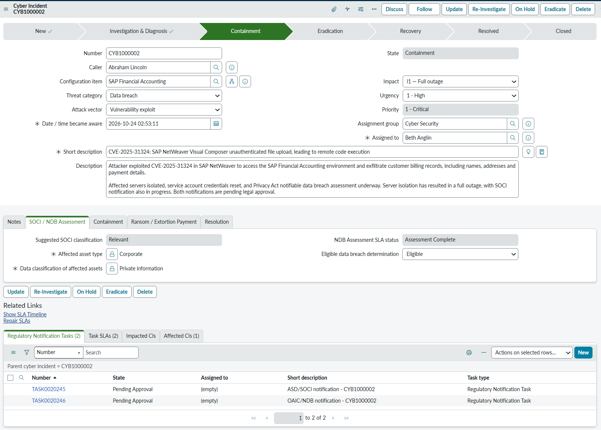
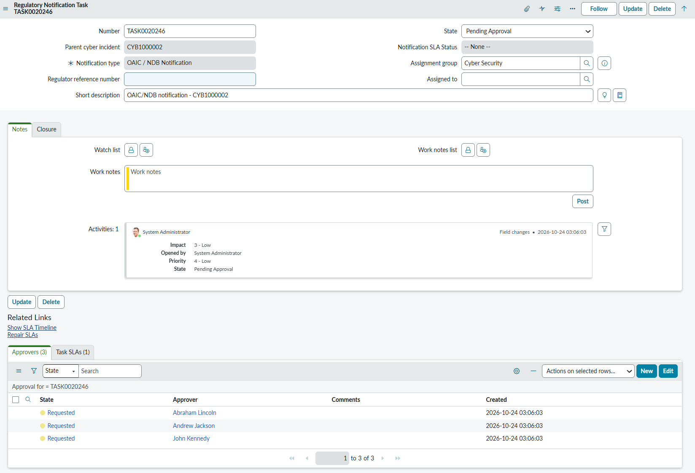
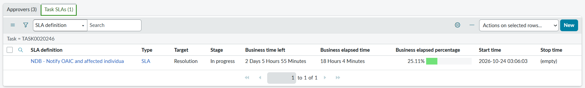
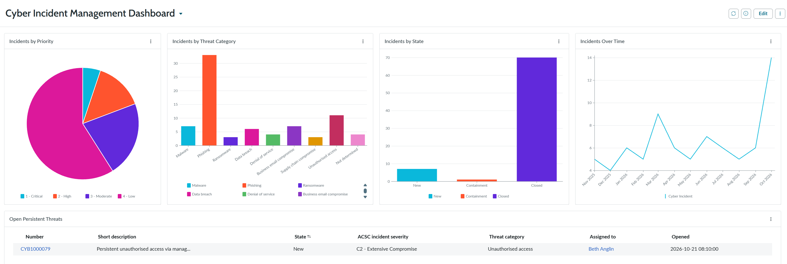

# ServiceNow Cyber Incident Management Application

A custom scoped ServiceNow application for running cyber incidents in line with Australian Cyber Security Centre (ACSC) guidance. It tracks an incident through containment, eradication and recovery, and creates notification tasks required to meet the regulatory reporting obligations of the SOCI Act, the Cyber Security Act (ransomware payments) and the Privacy Act (notifiable data breaches).

I built it on a personal developer instance as hands-on practice for the ServiceNow CSA and CAD certifications, and I've since passed both. My day job is an IT Service Management Process Lead for Major Incident and Problem Management, so the process design comes from my many years of experience in ITIL roles.

**Status.** v1.0 is complete (Labs 01 to 31). v2 is planned, see the roadmap below.

**Application source.** While this repo captures the application in update sets, it is also committed directly from ServiceNow Studio to [servicenow-studio-cyb-inc-app](https://github.com/eric-t-carroll/servicenow-studio-cyb-inc-app).

## Screenshots



Two regulatory pathways:
- the data breach triggers a Privacy Act notifiable data breach assessment
- the full outage meets the SOCI Act "relevant impact" threshold.

Both notification tasks are waiting on legal approval.




A regulatory notification task with its legal approval..




..and SLA.




The cyber incident dashboard.


## Key design decisions

- **Extends Task, not Incident.** Keeps cyber records out of the standard incident lists and views. It also keeps the core Incident table free of customisations that could impact future platform upgrades. In hindsight, I would create a custom table from scratch for this application if I did it again, so the records aren't mixed in with task table views.
- **Phase-gated lifecycle.** Form sections follow the cyber incident lifecycle: Investigation and Diagnosis, Containment, Eradication and Recovery. A state transition matrix is enforced server-side, with a UI action for each allowed transition. These UI actions are currently a bit 'clunky' and need an uplift to prompt the user for mandatory data before attempting to move to the next state.
- **Regulatory notifications are their own tasks.** A Regulatory Notification Task table holds SOCI Act (ASD), Privacy Act notifiable data breach (OAIC) and ransomware payment reporting tasks. Business rules create them from the incident's impact and data classification, using a SOCI classification matrix lookup.
- **Suggested, then confirmed by Legal.** A matrix suggests the SOCI classification from impact and data classification, and the notification task is created automatically. Legal reviews it and can change the classification before approving, because the classification sets the regulatory SLA.
- **SLAs with configurable targets.** Notification SLAs have documented reset, stop and cancel behaviour. Targets live in application properties which can be modified easily by a Cyber Incident Admin, and a scheduled job rolls up SLA status.
- **Priority never goes down.** Priority is mandatory from investigation onwards because it decides whether Major Incident Management gets involved. Once assessed, it isn't downgraded, so post incident reporting captures what really happened.
- **Locked-down access.** ACLs restrict the app to Major Incident Management, Cyber Analyst roles and Legal roles. Closed records are locked. People request access through an IT portal catalog item with an approval step. Once approved, the requestor is automatically added to the group they requested access to.
- **Persistent threat flag.** The flag drives the Open Persistent Threats report and currently triggers an email alert. That alert is a leftover from an early lab and will be removed. A persistent threat means normal communication channels can't be trusted, so v2 will replace it with a playbook that stops standard notifications and switches the response to a manual communications plan. The flag is hidden on the form until then.

The app also has reports and a dashboard, affected CIs linked from the CMDB, email notifications, and impact, urgency and priority configuration.

## Installing

**From source control.** In ServiceNow Studio, import the application from the [Studio repo](https://github.com/eric-t-carroll/servicenow-studio-cyb-inc-app.git).

**From update sets.**
1. Apply the update sets in lab order, starting with `update-sets/csa-labs` and then `update-sets/cad-labs`.
2. Import the groups XML from `data-exports` (right-click, Import XML on the groups list view).
3. Reassign roles and members for the Major Incident Management and Cyber Security groups.
4. Give the groups the ITIL role, including Legal. Without it, users can't edit fields inherited from Task and Legal can't approve notification tasks.
5. **Optional sample data.** `data-exports/cyber_incident_sample_data.xlsx` holds 77 generated incidents spread over a year, so the dashboard has something to show. Load it into the import set table with System Import Sets → Load Data, then run the "Sample Cyber Incidents" transform map. The map runs with business rules off, so the historical records keep their closed states and don't create notification tasks, SLAs or alerts. The data is fictional.

## Built with

- ServiceNow PDI, Zurich patch 6 (build: glide-zurich-07-01-2025__patch6-01-16-2026)
- Scope: `x_1776078_cyber_0` (scope name `cyber_0`)
- Main table: `x_1776078_cyber_0_cyber_incident`, extends `task`
- Number prefix: CYB, starting at CYB1000001

## AI-assisted development

I built this with Claude as a technical coach and lab guide. The project ideas and overall design are mine. Initially, Claude gave step-by-step lab instructions, design recommendations and answers to technical questions. I made the decisions, and I accepted, rejected or changed its advice based on my experience as a process lead and on testing. As I moved through the labs I began to work more independently, needing less step by step instructions and moving towards more general guidance for each lab.

For all scripting I wrote the code first, and Claude helped with questions and hints when I got stuck, sharing code only when I asked. For some challenging bugs that occurred later in the build debugging was closer to pair programming, with Claude helping in real time. I've tested and understand everything committed here.

I leaned on Claude heavily to draft the design documents. I started out just wanting hands-on ServiceNow experience and didn't realise how much design documentation a build needs. Now I do, and I'll write my own for future projects.

The most useful part was having a technical sounding board. Multiple regulatory notification pathways that have different start time criteria added complexity I wasn't expecting, and talking through the SLA triggers got me to a design that worked without hitting a string of roadblocks.

## Repository structure

```
servicenow-cyber-incident-app/
├── data-exports/        # User and group XML exports. Also contains sample incident data
├── design-docs/         # Design documents
├── docs/
│   ├── screenshots/     # README images
│   └── workflow.md      # My build and commit workflow
├── update-sets/
│   ├── csa-labs/        # Update sets from the CSA labs and coding challenges
│   └── cad-labs/        # Update sets from the CAD labs and coding challenges
├── LICENSE
└── README.md
```

## Branching strategy

| Branch | Purpose |
|--------|---------|
| `main` | Stable, completed work only. Merged into at the end of each completed lab. |
| `csa-labs` | Active branch for CSA phase labs (Labs 01-15). |
| `cad-labs` | Active branch for CAD phase labs (Labs 16-35). |

All work happens in the phase branch and merges into `main` when a lab is complete. My day-to-day steps are in [docs/workflow.md](docs/workflow.md).

## Lab index (v1)

| Lab | Name | Phase | Status |
|-----|------|-------|--------|
| 01 | PDI activation, GitHub repo and update set workflow | CSA | Completed |
| 02 | Scoped app creation and task table extension | CSA | Completed |
| 03 | ACSC-aligned custom fields and persistent threat flag | CSA | Completed |
| 04 | Custom form layout and views | CSA | Completed |
| 05 | State model and UI policies | CSA | Completed |
| 06 | ACLs to restrict access to MIM and security roles | CSA | Completed |
| 07 | IT portal access request form and approval workflow | CSA | Completed |
| 08 | Notifications and persistent threat email alert | CSA | Completed |
| 09 | Form hygiene, inbound email actions and 'time to triage' SLA | CSA | Completed |
| 10 | Reports and cyber incident dashboard | CSA | Completed |
| 11 | CMDB basics and linking affected CIs to incidents | CSA | Completed |
| 12 | Import sets, transform maps and data sources | CSA | Completed |
| 13 | Apply field register changes after design review | CSA | Completed |
| 14 | Multiple choice conversion | CSA | Completed |
| 15 | Scripted REST API to expose a Cyber Incident endpoint | CSA | Completed |
| 16 | Business rule for data classification checks | CAD | Completed |
| 17 | Regulatory Notification Task table | CAD | Completed |
| 18 | SOCI classification matrix lookup | CAD | Completed |
| 19a | Suggested/Confirmed approval pattern | CAD | Completed |
| 19b | Legal approval for REG task | CAD | Completed |
| 20 | ASD/SOCI notification trigger | CAD | Completed |
| 21 | OAIC/NDB notification trigger | CAD | Completed |
| 22a | Ransomware payment reporting trigger | CAD | Completed |
| 22b | Application properties for configurable SLA targets | CAD | Completed |
| 23 | SOCI warning/info banner | CAD | Completed |
| 24 | State transition matrix design and enforcement | CAD | Completed |
| 25a | Closure validation and record integrity ACL | CAD | Completed |
| 25b | REG task SLA definitions | CAD | Completed |
| 25b1 | ACL clean-up and lock down REG when closed | CAD | Completed |
| 25b2 | More REG task SLA definitions | CAD | Completed |
| 25c | Scheduled job for notification SLA status rollup | CAD | Completed |
| 26 | Configure impact, urgency and priority | CAD | Completed |
| 27 | Resolved and Resolved by, mandatory and auto-populated at closure | CAD | Completed |
| 28a | State transition UI actions | CAD | Completed |
| 28b | Special transition UI actions | CAD | Completed |
| 29 | REG task post-approval workflow and SOCI REG creation via business rule | CAD | Completed |
| 30 | CYB categorisation review | CAD | Completed |
| 31 | End-to-end application testing and go-live polish | CAD | Completed |

## Roadmap

### v2 lab index

| Lab | Name | Phase | Status |
|-----|------|-------|--------|
| 01 | Improve state transition UI Actions to prompt for mandatory data | CAD | Planned |
| 02 | Flow Designer automated lifecycle workflow | CAD | Planned |
| 03 | Script includes and GlideRecord API | CAD | Planned |
| 04 | Playbook Designer standard response playbook | CAD | Planned |
| 05 | Playbook Designer persistent threat branch, including disabling the previous persistent threat alert | CAD | Planned |
| 06 | End-to-end application testing (post-Playbooks) | CAD | Planned |
| 07 | ATF automated testing | CAD | Planned |
| 08 | IntegrationHub outbound notification spoke | CAD | Planned |
| 09 | Delegated Development walkthrough (role-play) | CAD | Planned |
| 10 | App Engine Studio polish | CAD | Planned |

### Other ideas for this app

- SLA rebuild with one scripted SLA per stage: Investigate, Contain and Eradicate, Recover.
- A way to return to the Investigation and Diagnosis state.
- Persistent threat mode: a continuous top-of-form banner, suppressing standard notifications, and a manual/out-of-band communications plan in the playbook.
- Problem record auto-creation on incident closure.
- A change advisory gate between containment, eradication, recovery (where required).
- A post-incident review table extending Task.
- A GlideRecord utility script include for common queries.
- Refine HTML email styling and wording once real outbound email is tested.
- Improve the access request catalog item, e.g. ticket updates when group auto-assignment completes.
- Set up real outbound email (SMTP) on the PDI.

### Ideas for after this app

- A Business Impact Assessment (BIA) application, with tasks for technical teams to record impacted services during a large-scale event. Later, BIA data and the type of data breached could adjust SLA targets dynamically.
- IntegrationHub outbound spoke for ASD notification (SOCI Act).

## Known issues

- After a programmatic `clearValue`/`setValue('')`, re-selecting "Regulated/Essential Services" as the first choice doesn't register.
- A before-update business rule using `setAbortAction(true)` on the REG task blocks list-view saves but not form saves. The workaround is a client script. Details are in the 8/9 learning below.

## Notable learnings

- **1/6:** I first extended the Incident table, then started again extending Task so CYB records didn't appear in incident lists and views. I'd do it as a fresh table from scratch next time, for full isolation.
- **5/6:** Testing a restore ('release instance and retrieve all update sets') showed the Lab 02 update set didn't capture creating the application scope. This is by design. After creating an application you have to publish it to an update set manually from the application record.
- **5/6:** Full restore using update sets worked. After importing the groups XML you still need to reassign roles and group members.
- **9/6:** Wrote a script version of "auto-assign new tickets to Cyber Security" for coding practice, then disabled it and built the same thing with assignment actions, which is best practice.
- **16/6:** Linking the app to source control through ServiceNow Studio created several 'historical' commits in the repo, which Studio then flagged as a discrepancy with my local version. I had to stash my work and pull those commits before I could commit the new lab. Studio also created a 'stash' update set, which turned out to be identical to the one I'd already exported. It has worked without issue since.
- **18/6:** Analysing the business process and writing design documents first would reduce development friction. I was making design decisions on the fly from my work experience.
- **18/6:** Reports are captured in update sets, dashboards aren't. You need to unload the dashboard so it lands in the same update set as the reports.
- **21/6:** Decided to write a proper design spec instead of winging it. Too many decisions were being made on the fly and I could see rework coming. It was also a chance to check the design against ACSC guidance and the other regulatory requirements.
- **9/7:** Retired priority and urgency phase-gating. The original design hid urgency until Recovery and left priority blank. Both are now mandatory from Investigation and Diagnosis onwards, because priority drives MIM engagement (P1/P2) and a blank priority meant MIM had no signal. A correctly assessed priority is never downgraded, so that post incident reporting remains accurate.
- **29/7:** Field messages must be set before clearing or setting values in an onChange script. Otherwise the value change clears the message.
- **2/8:** Full restore via source control and individual update sets completed successfully.
- **6/8:** Approval tasks need the `sysapproval` field set as well as `document_id`, or they don't appear in related approval lists.
- **8/8:** UI actions call a function from the onClick field, and the function is defined in the script field. `gsftSubmit` saves the form and triggers the server-side script.
- **9/8:** Field-level and wildcard ACLs get messy if you don't plan them before building them.
- **25/8:** The SLA engine appears to run SLA creation scripts twice. That made `notificationDueTime` behave like `+=`, adding the SLA days onto itself each time. Fixed by creating a new GlideDateTime so `notificationDueTime` is a copy of the ransomware payment time's value, not a reference to the original variable.
- **25/8:** Users need the ITIL role to edit fields inherited from Task. Next time I'd build the CYB table from scratch. I didn't end up using many inherited fields anyway - would be easy to recreate what's necessary.
- **2/9:** Complex SLAs are hard to design. A simpler design is probably the better outcome.
- **5/9:** Capped v1 at Lab 29 to spend time on polish before showing it to work colleagues. The remaining labs moved to v2. Passed my CAD exam.
- **8/9:** Couldn't get `setAbortAction(true)` to work from the REG task. The business rule works in list view but not on a form save. I ruled out condition logic, rule order, session context, table scope and interference from other scripts, but didn't find the root cause. I added a client script that removes the state the user was trying to save as, in specific scenarios.
- **9/9:** Simplified the design by making all REG task creation use the same workflows and business rules, and removed a few reporting fields that duplicated others. It feels like a better user experience.

## Reference standards

- [ACSC, Australian Cyber Security Centre](https://www.cyber.gov.au)
- [ACSC Essential Eight](https://www.cyber.gov.au/resources-business-and-government/essential-cyber-security/essential-eight)
- [ServiceNow Zurich release notes](https://docs.servicenow.com)
